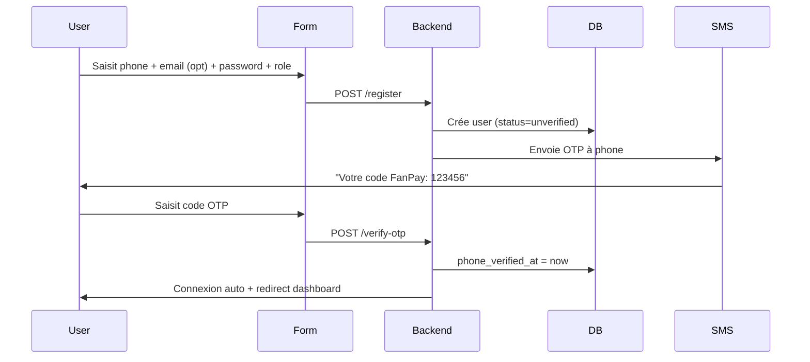

# 🔐 03 — Authentification, Utilisateurs & KYC

> **Stack :** Laravel Sanctum + OTP SMS (Unimatrix) + rôles natifs
> **Bilinguisme :** FR/EN dès la conception

---

## Table des matières

1. [Système d'authentification](#1-système-dauthentification)
2. [Rôles & permissions](#2-rôles--permissions)
3. [Flux OTP SMS](#3-flux-otp-sms)
4. [Vérification KYC artiste](#4-vérification-kyc-artiste)
5. [Profils artiste & mini-site](#5-profils-artiste--mini-site)
6. [2FA (optionnel)](#6-2fa-optionnel)

---

## 1. Système d'authentification

### 1.1 Identifiant principal

- **Numéro de téléphone** (`phone`) = identifiant principal (contrainte UNIQUE).
- Email facultatif mais recommandé (récupération de compte, reçus).
- À l'inscription, **OTP SMS obligatoire** pour vérifier le numéro.

### 1.2 Flux d'inscription



### 1.3 Flux de connexion

1. **Par mot de passe** : email/phone + password (standard).
2. **Par OTP** : saisie du numéro → réception OTP → connexion sans mot de passe (utile pour mobiles).

### 1.4 Implémentation technique

```php
// Routes
Route::post('/register', [AuthController::class, 'register'])->middleware('throttle:5,10');
Route::post('/login', [AuthController::class, 'login'])->middleware('throttle:10,1');
Route::post('/send-otp', [AuthController::class, 'sendOtp'])->middleware('throttle:3,5');
Route::post('/verify-otp', [AuthController::class, 'verifyOtp'])->middleware('throttle:5,1');

// Middleware
'session'  // Sessions web (Blade)
'auth:sanctum'  // API (Sanctum tokens pour webhooks)
```

**Rate limiting (throttle) :**
| Endpoint | Limite | Fenêtre |
|----------|--------|---------|
| `/register` | 5 requêtes | 10 minutes |
| `/send-otp` | 3 requêtes | 5 minutes |
| `/verify-otp` | 5 requêtes | 1 minute |
| `/login` | 10 requêtes | 1 minute |

---

## 2. Rôles & permissions

### 2.1 Hiérarchie des rôles

```
┌─────────────────────────────────────────────────────┐
│                    ADMIN                             │
│  (Supervision, KYC, payouts, paramètres, litiges)   │
├─────────────────────────────────────────────────────┤
│                    ARTISTE                           │
│  (Catalogue, événements, VIP, dédicaces, retraits)  │
├─────────────────────────────────────────────────────┤
│                     FAN                              │
│  (Achat, streaming, tip, vote, billetterie)         │
└─────────────────────────────────────────────────────┘
```

### 2.2 Permissions (Spatie Laravel Permission)

> On utilise **Spatie Laravel Permission** pour une gestion flexible des rôles et permissions.
> Les permissions sont définies en DB (table `permissions`) et assignées aux rôles (`roles`) ou directement aux utilisateurs.

**Définition des permissions :**
```php
// app/Providers/AuthServiceProvider.php
use Spatie\Permission\PermissionRegistrar;

public function boot(): void
{
    // Reset cache permissions au démarrage
    app()[PermissionRegistrar::class]->forgetCachedPermissions();
    
    // Définir les permissions
    Permission::create(['name' => 'upload-catalog']);
    Permission::create(['name' => 'create-event']);
    Permission::create(['name' => 'request-payout']);
    Permission::create(['name' => 'vote']);
    Permission::create(['name' => 'approve-kyc']);
    Permission::create(['name' => 'approve-payout']);
    Permission::create(['name' => 'manage-disputes']);
    Permission::create(['name' => 'manage-settings']);
    
    // Créer les rôles et assigner les permissions
    $role = Role::create(['name' => 'admin']);
    $role->givePermissionTo(Permission::all());
    
    $artistRole = Role::create(['name' => 'artist']);
    $artistRole->givePermissionTo(['upload-catalog', 'create-event', 'request-payout', 'vote']);
    
    $fanRole = Role::create(['name' => 'fan']);
    $fanRole->givePermissionTo(['vote']);
}
```

**Vérification dans le code :**
```blade
@can('upload-catalog')
    <x-button :href="route('artist.catalog.upload')">Uploader</x-button>
@endcan
```

```php
// Dans un controller
if ($user->can('request-payout') && $user->kycVerified()) {
    // Traiter la demande
}
```

### 2.3 Middleware de rôle

```php
// Filament gère nativement les rôles via `can()`.
// Pour les routes web, on utilise le middleware natif Spatie :
Route::middleware(['auth', 'role:artist|admin'])->group(function () {
    // Dashboard artiste
});
```

### 2.4 Liste des permissions par module

| Module | Fan | Artiste | Admin |
|--------|:---:|:-------:|:-----:|
| Streaming (écoute preview) | ✅ | ✅ | ✅ |
| Streaming (contenu complet) | ✅ acheté | ✅ | ✅ |
| Téléchargement achat | ✅ | ✅ | ✅ |
| Upload catalogue | ❌ | ✅ | ✅ |
| Création événement | ❌ | ✅ | ✅ |
| Achat billet | ✅ | ✅ | ❌ |
| Vente billet | ❌ | ✅ | ❌ |
| Plan VIP | ❌ | ✅ (créer) | ✅ |
| Abonnement VIP | ✅ | ✅ | ✅ |
| Demande dédicace | ✅ | ❌ | ❌ |
| Réponse dédicace | ❌ | ✅ | ❌ |
| Vote concours | ✅ | ✅ | ❌ |
| Création concours | ❌ | ❌ | ✅ |
| Retrait wallet | ❌ | ✅ | ✅ |
| Validation KYC | ❌ | ❌ | ✅ |
| Validation retrait | ❌ | ❌ | ✅ |
| Gestion litiges | ❌ | ❌ | ✅ |
| Paramètres généraux | ❌ | ❌ | ✅ |

---

## 3. Flux OTP SMS

### 3.1 Cas d'usage

| Usage | Quand | Coût |
|-------|-------|------|
| **Inscription** | Vérification du numéro | ~90 FCFA/SMS |
| **Connexion OTP** | Alternative au mot de passe | ~90 FCFA/SMS |
| **2FA retrait** | Avant validation d'un retrait (optionnel) | ~90 FCFA/SMS |
| **Réinitialisation mot de passe** | Vérification d'identité | ~90 FCFA/SMS |

### 3.2 Logique métier

```php
// Domain/Users/Actions/SendOtpAction.php
class SendOtpAction
{
    public function execute(string $phone, string $purpose): void
    {
        // 1. Vérifier throttling (max 3 envois/5 min)
        // 2. Générer code aléatoire 6 chiffres
        $code = str_pad(random_int(0, 999999), 6, '0', STR_PAD_LEFT);
        
        // 3. Stocker en DB (otp_codes)
        OtpCode::create([
            'phone' => $phone,
            'code' => Hash::make($code), // hashé en DB
            'purpose' => $purpose,
            'expires_at' => now()->addMinutes(5),
        ]);
        
        // 4. Envoyer SMS (queue)
        SendOtpSms::dispatch($phone, $code, $purpose);
        // → queue Redis, traité par CRON + flock
    }
}
```

### 3.3 Vérification OTP

```php
// Domain/Users/Actions/VerifyOtpAction.php
class VerifyOtpAction
{
    public function execute(string $phone, string $code, string $purpose): bool
    {
        // 1. Trouver le dernier OTP non expiré et non vérifié
        $otp = OtpCode::where('phone', $phone)
            ->where('purpose', $purpose)
            ->whereNull('verified_at')
            ->where('expires_at', '>', now())
            ->where('attempts', '<', 'max_attempts') // max 3 tentatives
            ->latest()
            ->first();
        
        if (!$otp || !Hash::check($code, $otp->code)) {
            $otp?->increment('attempts');
            return false;
        }
        
        // 2. Marquer vérifié
        $otp->update(['verified_at' => now()]);
        
        // 3. Marquer phone vérifié si inscription
        User::where('phone', $phone)->update(['phone_verified_at' => now()]);
        
        return true;
    }
}
```

### 3.4 Fournisseur SMS

```php
// app/Services/SmsService.php
interface SmsProvider
{
    public function send(string $phone, string $message): bool;
}

class UnimatrixProvider implements SmsProvider
{
    public function send(string $phone, string $message): bool
    {
        // Appel API Unimatrix
        // https://api.unimatrix.cm/v1/sms
        // Coût: ~90 FCFA/SMS
    }
}
```

---

## 4. Vérification KYC Artiste

### 4.1 Workflow complet

```
1. Artiste complète son profil (stage_name, bio, genre)
2. Clique "Demander vérification KYC"
3. Upload CNI (recto/verso) + saisit numéro MoMo
4. Status = pending
5. Admin reçoit notification (in-app + email)
6. Admin :
   a. Vérifie document (CNI)
   b. Vérifie que le numéro MoMo correspond au nom CNI
   c. ✅ Approuve (is_verified = true)
   d. ❌ Rejette (avec motif)
7. Artiste notifié
8. KYC validé = accès au retrait des fonds
```

### 4.2 Règles métier

- **KYC obligatoire** pour effectuer un premier retrait (payout).
- Un artiste peut uploader du contenu sans KYC, mais ne peut pas retirer.
- Le KYC selfie (photo avec CNI) est optionnel (peut être requis en cas de doute).
- En cas de rejet, l'artiste peut soumettre à nouveau après correction.

### 4.3 Contrôle technique

```php
// Vérification dans le modèle User
public function canRequestPayout(): bool
{
    return $this->role === 'artist'
        && $this->kycVerifications()
            ->where('status', 'approved')
            ->exists();
}
```

### 4.4 Protection des données KYC

- Les images CNI sont stockées sur B2/R2 (bucket privé, pas d'accès public).
- Le `id_number` peut être stocké chiffré (AES-256) en base.
- Durée de conservation : durée de vie du compte + 1 an après clôture (conformité loi 2024/017).
- Accès restreint aux admins uniquement.

---

## 5. Profils Artiste & Mini-site

### 5.1 Page publique artiste (mini-site)

```
URL : /artist/{slug}

Éléments :
├── Cover (bannière personnalisable)
├── Avatar (photo de profil)
├── Nom de scène + badge vérifié ✅
├── Bio (FR optionnellement EN)
├── Genre musical
├── Liens sociaux (Instagram, Twitter/X, YouTube, TikTok)
├── Bouton "Tip" (soutien)
├── Onglets :
│   ├── 🎵 Musique (albums, singles, clips)
│   ├── 🛍️ Boutique (produits numériques/physiques)
│   ├── 📅 Événements (concerts à venir)
│   └── ⭐ VIP (plans d'abonnement)
└── Classement / popularité (stats publiques)
```

### 5.2 Personnalisation

- Couleur primaire (navbar, boutons, accents)
- Police (sélection limitée)
- Image de couverture
- Couleur de fond

Stocké dans `artist_profiles.customization` (JSON) :
```json
{
    "primary_color": "#6B21A8",
    "background_color": "#FFFFFF",
    "font": "Inter",
    "cover_position": "center"
}
```

### 5.3 SEO

- URL propre : `/artist/{slug}`
- Balises meta dynamiques (title, description, og:image)
- Sitemap incluant toutes les pages artistes
- Schema.org `MusicGroup` ou `Person` (balisage structuré)

---

## 6. 2FA (Optionnel)

- Disable par défaut.
- Activation depuis les paramètres de sécurité du compte.
- À chaque retrait (payout), si 2FA activé → OTP SMS avant validation.
- Implémentation identique au flux OTP standard avec `purpose = '2fa'`.

---

> **Document suivant :** [`docs/04-payments-wallet.md`](./04-payments-wallet.md) — Paiements Mobile Money & Wallet interne
